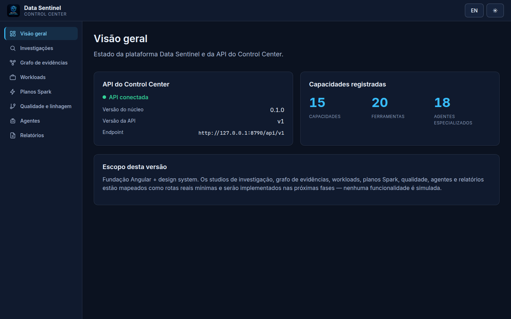

# Data Sentinel

<p align="center">
  
</p>

**Intelligent Data Engineering & Agentic Diagnostics Platform.**

Ferramenta open source (Apache-2.0) para investigar, analisar e explicar
problemas em workloads de engenharia de dados — logs Spark/Glue, queries SQL,
jobs e ambientes lakehouse — com diagnósticos **apoiados em evidência
auditável**. Nada de causa-raiz inventada: todo achado cita a evidência que o
sustenta e declara seu nível de confiança.

## O que é

- **Análise determinística primeiro**: analyzers executam regras curadas sobre
  artefatos locais; resultados fracos ficam `PROBABLE`/`POSSIBLE`/`UNKNOWN` em
  vez de virar diagnóstico fabricado.
- **Offline por padrão**: analisa logs e SQL locais sem nenhuma chamada de
  rede ou credencial cloud.
- **Read-only**: nunca altera recursos de produção; guardas de caminho,
  tamanho e sanitização protegem a entrada.
- **Auditoria built-in**: evidências são sanitizadas (segredos redigidos) e
  persistidas em SQLite local junto ao relatório versionado.

## Instalação

Requer Python ≥ 3.11.

```bash
# via uv (recomendado para desenvolvimento)
uv sync
uv run data-sentinel --help

# via pip
pip install .
data-sentinel --help
```

Detalhes: [docs/installation.md](docs/installation.md).

### Instalação agentic

Publica skills, agents e o servidor MCP nos hosts suportados (Claude,
Devin, Codex, Copilot):

```bash
data-sentinel install                    # interativo
data-sentinel install --yes --host all   # não-interativo
data-sentinel install status|doctor|env  # lifecycle
data-sentinel install uninstall          # remove só arquivos gerenciados
```

Guias por escopo/host/plataforma em [docs/installation/](docs/installation/).

## Quickstart

```bash
# Analisar um log de Glue/Spark (saída real abaixo)
data-sentinel analyze --file fixtures/logs/glue_oom.log

# Análise estática de SQL (AST SQLGlot, dialetos spark/trino)
data-sentinel sql analyze --file fixtures/joins/high_volume_4tables.sql --dialect spark

# Plano físico Spark (EXPLAIN) → árvore + estratégias + limitações
data-sentinel spark explain --file fixtures/plans/sort_merge_join.txt

# Pipeline composto: SQL + joins/cardinalidade + config advisor
data-sentinel spark optimize --sql query.sql --stats stats.json --config spark-defaults.conf

# AWS Glue read-only (requer [aws] + credenciais)
data-sentinel glue runs --job meu-job --limit 10 --region us-east-1
data-sentinel glue diagnose --job meu-job --run-id jr_abc --region us-east-1

# Saúde da instalação / capacidades / relatórios
data-sentinel doctor
data-sentinel capabilities [--descriptors]
data-sentinel import doctor-bundle -f <arquivo>
data-sentinel report show --id <report_id> --format markdown
```

Saída real de `analyze` sobre `fixtures/logs/glue_oom.log`:

```text
relatório 79e1efef4cd84f94882c76914aa9b760 (schema 1.0.0)
resumo: 1 achado(s): CONFIRMED=1

[HIGH/CONFIRMED] out_of_memory
  Assinatura inequívoca de java.lang.OutOfMemoryError indica que driver ou
  executor estourou o heap disponível. 2 ocorrência(s) no log analisado.
  evidência: fixtures/logs/glue_oom.log:5
    ... Lost task 0.1 ... : java.lang.OutOfMemoryError: Java heap space
  recomendação: Aumentar spark.driver.memory ou spark.executor.memory
  ...
```

Mais exemplos: [examples/README.md](examples/README.md) e
[docs/evidence/](docs/evidence/) (saídas capturadas de comandos reais).

## Control Center (Cycle 06)

Portal web real sobre o mesmo núcleo — API FastAPI (`data-sentinel serve`,
bind `127.0.0.1:8790`) + frontend Angular 20 (`frontend/`). Investigações
agênticas via `/api/v1/investigations`, stream SSE, grafo de evidências,
explorers de workloads/Spark/qualidade e registry de agentes — sem dado
simulado.

```bash
uv run data-sentinel serve --port 8790        # API → /api/v1/*
cd frontend && npx ng serve --port 4200       # portal → localhost:4200
```



Guia completo (endpoints, segurança, limitações):
[docs/guides/control-center.md](docs/guides/control-center.md).

## Códigos de saída

`0` sucesso · `1` erro de domínio/usuário · `2` erro de uso · `3` erro interno.
Ver [ADR 0006](docs/adr/0006-exit-code-scheme.md).

## Documentação

| Doc | Conteúdo |
|---|---|
| [docs/installation.md](docs/installation.md) | Instalação e requisitos |
| [docs/cli.md](docs/cli.md) | Referência dos comandos |
| [docs/configuration.md](docs/configuration.md) | Perfis, fontes, precedência |
| [docs/architecture.md](docs/architecture.md) | Arquitetura e módulos |
| [docs/security.md](docs/security.md) | Guardas, redação, postura read-only |
| [docs/development.md](docs/development.md) | Setup de dev, testes, lint |
| [docs/troubleshooting.md](docs/troubleshooting.md) | Erros comuns |
| [docs/roadmap.md](docs/roadmap.md) | Cycles 02–08 e backlog do Cycle 02 |
| [docs/validation-matrix.md](docs/validation-matrix.md) | Matriz de validação com evidências |
| [docs/cycle-01-report.md](docs/cycle-01-report.md) | Relatório final do Cycle 01 |
| [docs/cycles/cycle-02-final-report.md](docs/cycles/cycle-02-final-report.md) | Relatório final do Cycle 02 |
| [docs/guides/](docs/guides/) | Guias por funcionalidade (Glue, CloudWatch, plano, SQL, joins, config) |
| [docs/examples/](docs/examples/) | Exemplos executáveis com saídas reais |
| [docs/adr/](docs/adr/) | Decisões arquiteturais |

## Estrutura

```text
src/data_sentinel/
├── core/          # contracts, configuration, security, exceptions
├── analyzers/     # registry + spark/{log,plans,joins,config} + sql + cloudwatch
├── connectors/    # aws/{glue,cloudwatch_logs} — extra [aws], read-only
├── diagnostics/   # orchestrator + correlation + timeline
├── reporting/     # renderers terminal/JSON/Markdown
├── persistence/   # SQLite store + migrations (stdlib)
├── api/           # FastAPI app (Cycle 06) — `data-sentinel serve`, /api/v1/*
├── agents/ + tools/ + mcp/   # runtime agêntico + registry + MCP (Cycle 05)
└── cli/           # Typer app

frontend/          # Angular 20 Control Center (Cycle 06) — raiz do repo
```

## Estado do projeto

**Cycle 08.2 implementado** — installer portátil universal: CLI
`data-sentinel install` (interativo + `--yes`), adapters para
Claude/Devin/Codex/Copilot (Cursor declarado sem catálogo), 5 skills +
3 agents versionados na wheel com `MANIFEST.sha256`, MCP lifecycle
(`mcp serve`, handshake real), `forge.json`/`forge.agentic.json` para
descoberta Forge CLI, lifecycle auditável (ledger sha256, receipts,
repair, uninstall preservando arquivos do usuário) e
`install env`/`status`/`doctor`. Evidência:
[docs/cycles/cycle-08-2-final-report.md](docs/cycles/cycle-08-2-final-report.md).
Cycle 06: Control Center Angular + API
([cycle-06](docs/cycles/cycle-06-final-report.md)); ciclo anterior em
[cycle-08-1](docs/cycles/cycle-08-1-final-report.md).
**1025 testes Python + 96 specs Angular + ~145 Playwright, ruff+mypy
strict limpos.**
Ciclos anteriores: [cycle-05](docs/cycles/cycle-05-final-report.md),
[05.1](docs/cycles/cycle-05-1-final-report.md),
[04](docs/cycles/cycle-04-final-report.md).

## Licença

Apache-2.0 — ver [LICENSE](LICENSE).

## Cycle 03 — Lakehouse (Iceberg, Lake Formation, cross-account)

```bash
data-sentinel lakehouse metadata -f metadata.json   # Iceberg metadata
data-sentinel lakehouse access   -f contexto.json   # cross-account
data-sentinel lakehouse policy   -f policy.json     # IAM/S3/KMS offline
data-sentinel lakehouse operation -f merge.sql      # MERGE/APPEND
data-sentinel lakehouse compat --runtime glue-5.1 --operation merge \
    --access-mode fgac                              # compatibilidade
```

Ver `docs/cycles/cycle-03-final-report.md` e guias em `docs/guides/`.
